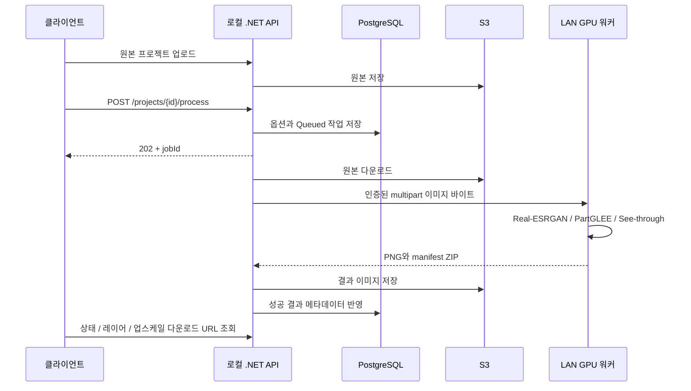

# 로컬 GPU 이미지 처리

> 현재 학교 Windows/WSL2 워크스테이션의 설치 상태와 정확한 재개 절차는
> [Local GPU workstation handoff](local-gpu-workstation-handoff.md)에 기록되어 있습니다.

## 구성과 구현 범위

API 컴퓨터는 기존 .NET 8 API, PostgreSQL, S3 접근을 담당합니다. 같은 LAN의 별도 NVIDIA GPU 컴퓨터에서 Python HTTP 워커와 모델을 실행합니다. GPU 컴퓨터에 DB/AWS 자격 증명을 전달하지 않습니다. GPU 추론에 Replicate 토큰이나 클라우드 GPU는 필요하지 않습니다. 기존 인증(Cognito/JWT)과 이미지 저장소(S3)는 그대로 사용하므로 서비스 전체가 오프라인 구성인 것은 아닙니다.



| 기능 | 구현 | 한계 |
|---|---|---|
| 업스케일 | 로컬 Real-ESRGAN `RealESRGAN_x4plus` | 4× 모델의 2×/4× 출력, 기본 타일 256 |
| 일반 사진 2.5D | PartGLEE RN50 PACO 객체·부위 마스크 → 투명 PNG + 배경 보간 | 세로 위치 기반 깊이 추정, OpenCV Telea 배경 채움. 실제 깊이/가려진 물체 복원/리깅 아님 |
| 애니메이션 캐릭터 2.5D | See-through 공식 PSD 파이프라인 → 전체 캔버스 PNG | 캐릭터 도메인에 적합. PSD 그리기 순서로 시차 깊이 부여 |

일반 사진은 `PartGlee`를 명시합니다. PartGLEE는 이 어댑터에서 PACO 어휘를 사용하므로 모든 객체를 인식한다고 보장하지 않습니다. 임계값을 넘는 마스크가 없으면 실패로 기록합니다. 작은 부위를 우선 분리하고 겹치는 객체 마스크는 남은 픽셀만 사용합니다. 배경 인페인팅에는 복원 흔적이 생길 수 있으며 이동량은 기존 레이어 PATCH API로 조정할 수 있습니다.

레이어는 기본 최대 변 1280으로 생성합니다. 업스케일과 레이어 변환을 함께 요청하면 업스케일 결과를 레이어 엔진 입력으로 사용하지만, 레이어 엔진 해상도 제한은 계속 적용됩니다. 고해상도 업스케일 PNG는 별도로 보존합니다. 최종 렌더링은 기존 클라이언트의 레이어 시차 효과를 사용합니다. 이번 변경에는 모바일 UI/APK 생성이 포함되지 않습니다.

## GPU 컴퓨터 준비

CUDA 및 컴파일 확장 의존성 때문에 Linux 또는 NVIDIA CUDA가 정상 인식되는 WSL2 환경을 기준으로 준비합니다. 네이티브 Windows의 모델 설치 호환성은 별도 확인이 필요합니다. 아래 세 모델의 환경을 합치지 않습니다. 워커 HTTP 환경에는 PyTorch가 필요하지 않습니다.

확인한 소스와 재현용 ref:

| 프로젝트 | 확인한 ref | 설치/모델 |
|---|---|---|
| [See-through](https://github.com/shitagaki-lab/see-through) | `df019de5129d6c4b406587a14c3501669441a783` | 공식 README의 Python 3.12/CUDA 환경, 모델 자동 다운로드 및 assets 링크 |
| [PartGLEE](https://github.com/ProvenceStar/PartGLEE) | `8c6b83e0be076e8fe640943096059ee5c180de0e` | [INSTALL](https://github.com/ProvenceStar/PartGLEE/blob/master/assets/INSTALL.md), [MODEL_ZOO](https://github.com/ProvenceStar/PartGLEE/blob/master/assets/MODEL_ZOO.md) |
| [Real-ESRGAN](https://github.com/xinntao/Real-ESRGAN) | `a4abfb2979a7bbff3f69f58f58ae324608821e27` | 공식 설치 절차, `RealESRGAN_x4plus.pth` |

모델 저장소는 이 프로젝트 외부에 clone하고 위 ref로 checkout합니다. 각 저장소의 라이선스와 모델 사용 조건을 확인합니다. 코드/가중치는 이 저장소에 복제하지 않습니다.

1. **Real-ESRGAN**: 공식 의존성을 설치한 환경에서 `from realesrgan import RealESRGANer`가 성공해야 합니다. x4plus 가중치를 로컬 파일로 준비합니다. 타일 크기를 줄여 VRAM 사용량을 조정할 수 있습니다.
2. **PartGLEE**: 공식 Python 3.9/PyTorch 2.1/CUDA 12.1 설치 지침을 출발점으로 사용합니다. 저장소의 Detectron2를 `pip install -e .`로 설치하고 Deformable DETR 확장을 컴파일합니다. `projects/PartGLEE/clip_vit_base_patch32/`의 CLIP 설정·토크나이저·가중치를 준비합니다. RN50 체크포인트와 RN50 PACO YAML을 짝지어 사용합니다. 어댑터가 저장소 루트에서 `build_model`과 `DetectionCheckpointer`를 이용하여 단일 이미지 추론을 실행합니다. 학습/평가 데이터셋 전체를 다운로드할 필요는 없습니다.
3. **See-through**: 공식 환경과 `psd-tools`를 준비하고 `inference/scripts/inference_psd.py --srcp ... --save_to_psd`를 먼저 실행해 봅니다. 공식 안내의 기본 1280 처리에는 약 12–16GB VRAM이 필요합니다. `UPSCALE_WORKER_SEE_THROUGH_GROUP_OFFLOAD=true`를 지원합니다. NF4/블록 스왑 변형은 이 어댑터에서 선택하지 않습니다.

최초 모델 다운로드에는 인터넷이 필요할 수 있습니다. 이후에도 완전 오프라인 실행 여부는 준비된 캐시/가중치에 따라 직접 검증합니다. 각 모델 환경에서 `python -c "import torch; print(torch.cuda.is_available())"`로 CUDA를 확인합니다.

## GPU HTTP 워커 실행

GPU 컴퓨터에도 이 브랜치를 복사한 뒤:

```bash
cd backend/ai-worker
python3.12 -m venv .venv
.venv/bin/python -m pip install -r requirements.txt
# 아래 환경변수는 실제 로컬 경로와 키로 설정합니다.
export UPSCALE_WORKER_API_KEY='<32자 이상의 무작위 공유 키>'
export UPSCALE_WORKER_WORK_DIR='/srv/upscale-worker/jobs'
export UPSCALE_WORKER_REALESRGAN_REPOSITORY='/srv/models/Real-ESRGAN'
export UPSCALE_WORKER_REALESRGAN_PYTHON='/srv/envs/realesrgan/bin/python'
export UPSCALE_WORKER_REALESRGAN_WEIGHTS='/srv/models/Real-ESRGAN/weights/RealESRGAN_x4plus.pth'
export UPSCALE_WORKER_PARTGLEE_REPOSITORY='/srv/models/PartGLEE'
export UPSCALE_WORKER_PARTGLEE_PYTHON='/srv/envs/partglee/bin/python'
export UPSCALE_WORKER_PARTGLEE_WEIGHTS='/srv/models/PartGLEE/projects/PartGLEE/checkpoint/PartGLEE_RN50.pth'
export UPSCALE_WORKER_SEE_THROUGH_REPOSITORY='/srv/models/see-through'
export UPSCALE_WORKER_SEE_THROUGH_PYTHON='/srv/envs/see-through/bin/python'
.venv/bin/python -m uvicorn worker:create_app --factory --host 0.0.0.0 --port 8090 --workers 1
```

키는 ASCII 영문·숫자 등 공백 없는 무작위 값으로 생성하고 API에 같은 값을 설정합니다. 모든 환경변수와 기본값은 [GPU 설정 예시](../backend/ai-worker/.env.example), [worker_config.py](../backend/ai-worker/worker_config.py)에 있습니다. `.env` 파일은 자동으로 읽지 않습니다. shell에서 export하거나 별도 로컬 실행 환경으로 전달합니다.

**단일 GPU 워커 프로세스(`--workers 1`)와 단일 API 인스턴스**를 사용합니다. 프로세스 내부 직렬화이며 분산 스케줄러가 아닙니다. GPU가 사용 중이면 429를 반환합니다. GPU 모델은 호출마다 별도 프로세스로 실행하고 종료하여 환경 충돌과 VRAM 잔류를 줄이며, 모델 재로딩 시간이 추가됩니다.

GPU 포트는 API 컴퓨터만 접근하도록 로컬 방화벽을 설정합니다. WSL2 사용 시 API 컴퓨터에서 도달 가능한 주소/포트 전달을 확인합니다. 공유 키를 평문 HTTP로 전달하는 예시는 신뢰 가능한 사설 LAN용입니다. 신뢰 경계 밖의 네트워크에서는 TLS 또는 VPN을 적용합니다.

```bash
curl -H "X-Worker-Key: $UPSCALE_WORKER_API_KEY" http://GPU_LAN_HOST:8090/health
curl --fail-with-body -H "X-Worker-Key: $UPSCALE_WORKER_API_KEY" \
  -F file=@sample.png -F operation=upscale -F scale=2 \
  http://GPU_LAN_HOST:8090/v1/process --output result.zip
```

`/health`의 `configuredCapabilities`는 설정 존재 여부이며 실제 GPU/가중치 추론 검증이 아닙니다(`gpuVerified: false`). 위 이미지 요청 성공으로 별도 검증합니다. 지원 operation은 `upscale`, `layers`, `upscale_layers`, engine은 `partglee`, `see-through`입니다.

기본 입력 20MiB/16M 픽셀, 업스케일 출력 64M 픽셀, ZIP 256MiB, 레이어 64개까지입니다. 단일 프레임 이미지(Pillow 디코더 지원 범위)를 처리합니다. GIF 등 다중 프레임은 거부합니다. 4×에서는 입력 픽셀 수가 4M 이하여야 출력 64M 제한에 맞습니다. 파일명/URL/명령어/모델 경로를 요청으로 받아 실행하지 않습니다. 결과 전송 후 임시 디렉터리를 삭제합니다. 강제 전원 종료로 남은 `jobs/job-*`는 워커 정지 후 정리할 수 있습니다.

## API 컴퓨터 설정과 DB

기존 README의 PostgreSQL/S3/Cognito/JWT 설정을 완료한 뒤 `backend`에서 실행합니다.

```powershell
dotnet user-secrets set --project src/UpscaleLab.Api 'LocalGpu:Enabled' 'true'
dotnet user-secrets set --project src/UpscaleLab.Api 'LocalGpu:BaseUrl' 'http://GPU_LAN_HOST:8090'
dotnet user-secrets set --project src/UpscaleLab.Api 'LocalGpu:ApiKey' '<GPU와 동일한 무작위 공유 키>'
dotnet user-secrets set --project src/UpscaleLab.Api 'LocalGpu:TimeoutMinutes' '35'
dotnet ef database update --project src/UpscaleLab.Infrastructure --startup-project src/UpscaleLab.Api
dotnet run --project src/UpscaleLab.Api
```

`AddLocalGpuProcessing` migration은 작업 옵션/결과 키/크기와 프로젝트별 활성 작업 하나만 허용하는 unique index를 추가합니다. 기존 DB에 같은 프로젝트의 `Queued`/`Processing` 중복 행이 있으면 원인을 확인하고 정리한 뒤 적용합니다. 기존 행은 `Layers`/`SeeThrough`/2로 유지됩니다. 이번 개발 과정에서는 실제 DB에 migration을 적용하지 않습니다.

GPU 워커 기본 제한은 30분, API는 전송 시간을 포함하여 35분입니다. 변경할 때 API 제한을 더 길게 설정합니다. LocalGpu가 꺼져 있으면 기존 API 컴퓨터의 See-through 실행만 허용하며 새 업스케일/PartGLEE 요청은 명확히 실패합니다. 로컬 GPU 경로에서 Replicate를 자동 대체 호출하지 않습니다.

## API 테스트 순서

인증 후 Swagger 또는 기존 `POST /api/projects` multipart 업로드로 `projectId`를 받습니다. 일반 이미지도 같은 프로젝트 업로드 경로를 사용합니다.

```http
POST /api/projects/{projectId}/process
Authorization: Bearer <JWT>
Content-Type: application/json

{"operation":"UpscaleAndLayers","layerEngine":"PartGlee","upscaleFactor":2}
```

`Upscale`은 업스케일 PNG만, `Layers`는 레이어만 생성합니다. `UpscaleAndLayers`는 두 결과를 생성합니다. `layerEngine`은 `PartGlee` 또는 `SeeThrough`, 배율은 2/4입니다. 본문 없는 기존 호출은 `Layers`/`SeeThrough`/2를 사용합니다.

1. 응답은 `202`와 `jobId`입니다. `GET /api/projects/{projectId}/processing-status`로 `Queued → Processing → Completed/Failed`를 조회합니다. progress는 실제 모델 퍼센트가 아닌 단계 값(5/15/80/100)입니다.
2. 완료 후 `GET /api/projects/{projectId}/layers`로 기존 클라이언트 형식의 레이어를 받습니다.
3. 업스케일 결과는 `POST /api/projects/{projectId}/jobs/{jobId}/download-url`에서 15분 URL과 width/height를 받습니다. `processing-status`에도 `hasUpscaledImage`, `outputWidth`, `outputHeight`가 포함됩니다. 출력 크기는 업스케일 PNG 기준입니다.
4. 실패 후 같은 process API를 호출하면 새 작업을 만듭니다. 과거 완료 업스케일은 기존 jobId로 접근할 수 있으며 프로젝트 삭제 시 함께 삭제됩니다.

다른 사용자의 프로젝트/결과는 404입니다. 중복 작업과 처리 중 프로젝트 삭제는 409입니다. 기존 레이어는 성공한 레이어 작업에서만 교체됩니다. 업스케일만 요청하거나 처리 실패 시 기존 레이어를 보존합니다. API 종료 취소는 Queued로 돌려 재시작 시 재시도하며, GPU 워커에 남은 요청이 진행 중이면 429로 실패할 수 있습니다. 워커가 유휴 상태가 된 후 다시 요청합니다. 자동 재시도는 API 시작 시 복구에 한정하며, 실패 작업을 무한 재시도하지 않습니다.

## 검증

```powershell
dotnet build backend/UpscaleLab.sln
dotnet test backend/UpscaleLab.sln
cd backend/ai-worker
python -m venv .venv
.venv/Scripts/python.exe -m pip install -r requirements-test.txt
.venv/Scripts/python.exe -m unittest discover -s tests -v
```

Python HTTP/패키징 테스트는 가짜 모델 실행기를 명시적으로 주입하고 실제 GPU 모델을 로드하지 않습니다. 실제 코드 경로에는 더미 결과/리사이즈 성공 대체가 없습니다. 이 개발 PC에서 검증하는 범위는 .NET 서비스/전송/ZIP 검증과 Python 인증·옵션·직렬화·이미지 포맷·레이어 추출 보조 로직입니다. 별도 GPU 컴퓨터에서 세 모델별 실영상 추론, VRAM 및 처리시간, 결과 품질 검증이 필요합니다. 자동 배포/CI/CD는 추가하지 않습니다.
